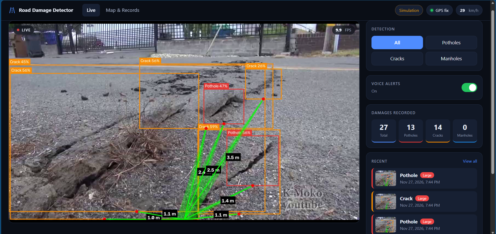
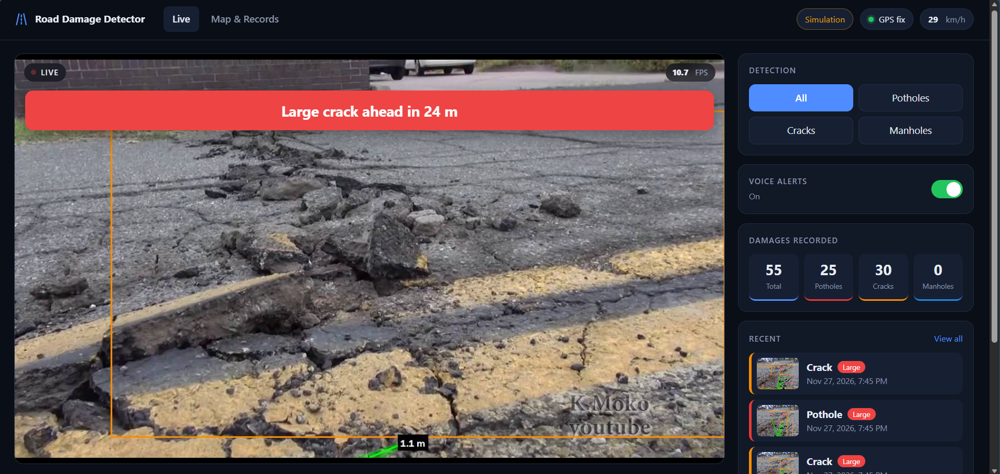
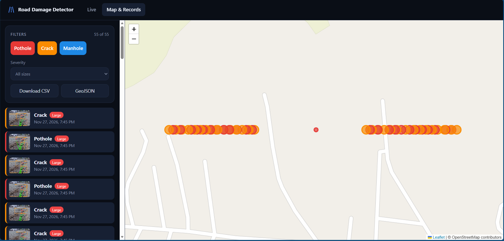
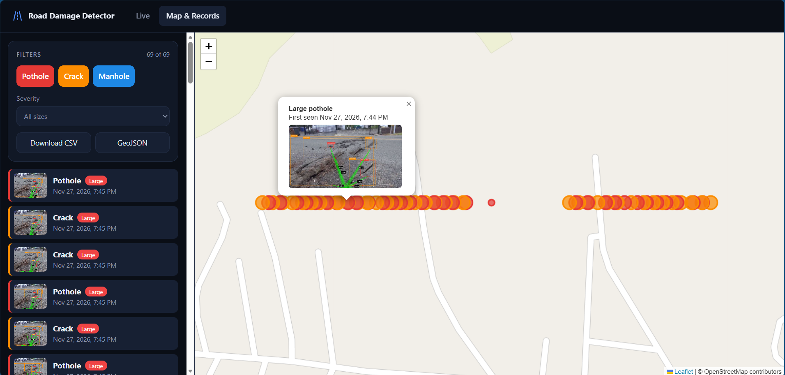

# Road Damage Detector

A Flask + YOLO application that watches the road through a camera and detects **potholes, cracks and manholes** in real time. It is built for a **Raspberry Pi** mounted in a vehicle, but it also runs on **Windows** (with a simulated GPS) for development and testing.

Every confirmed damage is saved together with its GPS position, severity and a photo. When you drive the same road again, the app **warns you by voice and on screen** before you reach a known damage, and it automatically deletes damages that are no longer found (probably repaired).

## Demo

| | |
|---|---|
|  |  |
|  |  |

https://youtu.be/NeAMBW2puLE

> **Project status:** developed and tested in simulation mode (simulated GPS) on a PC. The Raspberry Pi setup below follows the official Pi 4 / Pi 5 pinout guides and has not been verified on every hardware combination. Feedback and issue reports from real vehicles are welcome.

## Features

- Live camera stream (MJPEG) with bounding boxes and class labels
- Distance to each damage from camera geometry (no extra sensor), drawn as a line on the video
- Severity estimate (Small / Medium / Large) from the real-world size of the damage
- Damage is saved only after several sightings (`CONFIRM_HITS`), so one-frame false positives are ignored
- GPS position of every damage stored in a local SQLite database (`damages.db`)
- Voice alerts from your own MP3 files: when a damage is seen, and "ahead" warnings from stored GPS data
- Auto-removal of damages you drove past `REPAIR_PASSES` times without seeing them
- Web dashboard: **Live** page and **Map & Records** page with filters, photos, CSV and GeoJSON export
- Works on Windows with a simulated car, so you can test without any hardware

## How it works

1. One background thread reads the camera and runs YOLO on each frame.
2. The bottom edge of each detection box is converted to a ground distance using the camera height, pitch and vertical field of view (the `.env` values).
3. That distance is projected along the GPS heading to get the damage's latitude / longitude.
4. After `CONFIRM_HITS` sightings within `CONFIRM_RADIUS` metres the damage is stored and a photo is saved.
5. While driving, the stored damages in front of the vehicle (within about 5 seconds of travel, 40 to 200 m) trigger a spoken and on-screen warning.

## Project structure

```
road-damage-detector/
├── app.py                  # Flask server, detection loop, voice, API
├── .env                    # your own settings
├── .gitignore
├── logs/                   # logs files (train_logs, pinout and  Credits and Acknowledgements)
├── requirements.txt        # works on Windows and Linux / Raspberry Pi
├── best.pt                 # trained YOLO model (used on PC)
├── best_ncnn_model/        # exported model (used on the Pi)
├── deploy/
│   ├── road-damage.service # systemd service template (autostart on boot)
│   └── install_service.sh  # installs and enables the service
├── core/
│   └── gps.py              # GPS reader, FakeGPS simulator, damage database
├── templates/
│   ├── base.html
│   ├── index.html          # Live page
│   └── map.html            # Map & Records page
├── static/
│   ├── css/main.css
│   ├── js/common.js
│   ├── js/main.js
│   ├── js/map.js
│   ├── photos/             # created automatically
│   └── vendor/leaflet/     # optional offline copy of Leaflet
├── voice/                  # your MP3 alert files (see "Voice files")
├── docs/                   # image1.png ... image4.png
└── damages.db              # created automatically on the Pi (damages_sim.db on Windows)
```

## Hardware (Raspberry Pi)

| Part | Notes |
|---|---|
| Raspberry Pi 4 or Raspberry Pi 5 | 64-bit Raspberry Pi OS recommended |
| Power supply | Pi 4: USB-C 5 V / 3 A. Pi 5: use the official 27 W (5 V / 5 A) supply |
| Camera | USB webcam (works out of the box) or Pi Camera v2 / v3 (see the camera note below) |
| NEO-6M GPS module | Connected to the UART pins, see the wiring section |
| Speaker | Powered speaker. Pi 4: 3.5 mm jack. **Pi 5 has no 3.5 mm jack**: use a USB speaker / USB audio adapter, HDMI audio or Bluetooth |

## Wiring: NEO-6M GPS to the Raspberry Pi

The GPS module uses the Pi's hardware UART. The pin numbers are the same on the Pi 4 and the Pi 5. **TX and RX are crossed**: the GPS transmits, the Pi receives, and the other way round.

| GPS pin | Raspberry Pi pin | Purpose |
|---|---|---|
| VCC | 3.3 V, physical pin 1 | Power |
| GND | GND, physical pin 6 | Common ground |
| TX | GPIO15 / RXD, physical pin 10 | GPS sends data, Pi receives |
| RX | GPIO14 / TXD, physical pin 8 | Pi sends commands, GPS receives |

```
   NEO-6M GPS                     Raspberry Pi 40-pin header
  ┌──────────┐
  │ VCC ─────┼──────────────────► Pin 1  (3.3 V)
  │ GND ─────┼──────────────────► Pin 6  (GND)
  │ TX  ─────┼──────────────────► Pin 10 (GPIO15 / RXD)
  │ RX  ◄────┼──────────────────  Pin 8  (GPIO14 / TXD)
  └──────────┘
```

Other connections:

| Component | Connection |
|---|---|
| Pi Camera v2 / v3 | CSI port with the ribbon cable (check the orientation and close the latch) |
| USB webcam | Any USB port (a blue USB 3.0 port on the Pi 4 / 5) |
| Powered speaker | 3.5 mm jack on the Pi 4. On the Pi 5 use USB audio, HDMI or Bluetooth |
| Power | USB-C |

**Electrical safety**

- Power the Pi off while wiring.
- The NEO-6M chip itself needs 2.7 to 3.6 V. Many breakout boards have a regulator and accept more, but check the documentation of **your** board before choosing 3.3 V or 5 V.
- Raspberry Pi GPIO is **3.3 V logic and not 5 V tolerant**. The GPS TX line going into the Pi must not exceed 3.3 V (use a level shifter if it does).

## Setup on Windows (testing with simulated GPS)

On Windows the app automatically uses a **simulated GPS**: a fake car drives 600 m along a straight line at about 29 km/h, and one test pothole is placed 300 m along the route. Voice files play through the built-in Windows audio, so nothing extra is needed.

1. Install **Python 3.10, 3.11 or 3.12** from python.org (tick "Add Python to PATH").
2. Open a terminal in the project folder and create a virtual environment:
   ```bat
   python -m venv .venv
   .venv\Scripts\activate
   ```
3. Install the packages:
   ```bat
   pip install --upgrade pip
   pip install -r requirements.txt
   ```
4. Copy `.env.example` to `.env` and adjust the values (see "Configuration").
5. Make sure `best.pt` is in the project folder, and the MP3 files are in `voice/`.
6. Run:
   ```bat
   python app.py
   ```
7. Open <http://localhost:5000>.

> If a folder named `best_ncnn_model` exists, the app uses it (at `imgsz=320`) instead of `best.pt`. On Windows, remove or rename that folder if you want the normal 640 px model.

## Setup on Linux / Raspberry Pi

### 1. System packages

```bash
sudo apt update
sudo apt install -y python3-venv python3-pip mpg123
```

`mpg123` plays the voice files. Without it the app prints "mpg123 is not installed" and stays silent.

### 2. Enable the serial port for the GPS

```bash
sudo raspi-config
```

`Interface Options` → `Serial Port` → login shell over serial: **No** → serial port hardware enabled: **Yes**. Then make sure `/boot/firmware/config.txt` contains:

```
enable_uart=1
```

(On older Raspberry Pi OS versions the file is `/boot/config.txt`.)

**Raspberry Pi 5 note:** the Pi 5 uses its dedicated 3-pin debug UART as the primary UART by default, so `enable_uart=1` is what routes the UART to GPIO14 / GPIO15 on the 40-pin header. Make sure no serial login console uses the same port, then reboot.

Allow your user to read the serial port, then reboot:

```bash
sudo usermod -aG dialout $USER
sudo reboot
```

Check that the GPS is talking (go outside or near a window; NMEA lines starting with `$GP` or `$GN` should scroll):

```bash
ls -l /dev/serial0
stty -F /dev/serial0 9600
cat /dev/serial0
```

The first fix can take a few minutes. On many NEO-6M boards the LED starts blinking when a fix is found. The app uses `/dev/serial0` at 9600 baud; if your GPS is on USB, change `GPS_PORT` in `core/gps.py` to `/dev/ttyUSB0` or `/dev/ttyACM0`.

### 3. Python environment and packages

Raspberry Pi OS Bookworm and newer block `pip install` outside a virtual environment, so always use one:

```bash
cd road-damage-detector
python3 -m venv .venv
source .venv/bin/activate
pip install --upgrade pip
pip install -r requirements.txt
```

The first install downloads PyTorch and takes a while on a Pi.

### 4. Configuration and model

```bash
cp .env.example .env
nano .env          # set CAM_HEIGHT, PITCH_DEG, VFOV_DEG
```

For speed on the Pi, export the model to NCNN once (on the Pi or on your PC) and put the resulting `best_ncnn_model/` folder next to `app.py`:

```bash
yolo export model=best.pt format=ncnn imgsz=320
```

`imgsz=320` must match `IMGSZ = 320` in `app.py`. If `best_ncnn_model/` is missing, the app falls back to `best.pt` at 640 px, which is much slower on a Pi.

### 5. Run

```bash
python app.py
```

Open `http://<pi-ip-address>:5000` from any phone or laptop on the same network (find the address with `hostname -I`).

### 6. Start automatically on boot (optional)

The `deploy/` folder contains a [systemd](https://systemd.io/) service template and an installer. The installer detects your user name, project folder and virtual environment, so nothing has to be edited by hand.

First make sure the app works when started manually (`python app.py`, step 5). Then, from the project folder, run **as your normal user** (not with `sudo`, the script asks for `sudo` itself):

```bash
bash deploy/install_service.sh
```

The script:

- adds your user to the `dialout` (GPS serial port), `video` (camera) and `audio` groups
- enables *lingering* for your user so the audio session is available at boot without logging in
- writes `/etc/systemd/system/road-damage.service` using your paths (it prefers `.venv/`, then `venv/`, then the system `python3`)
- enables the service and starts it immediately

Reboot and open `http://<pi-ip-address>:5000`. The service restarts the app automatically if it crashes.

Useful commands:

```bash
sudo systemctl status road-damage          # is it running?
journalctl -u road-damage -f               # live log (prints and errors)
sudo systemctl restart road-damage         # after editing app.py or .env
sudo systemctl disable --now road-damage   # stop and remove autostart
```

<details>
<summary>Manual installation (without the script)</summary>

Copy `deploy/road-damage.service` to `/etc/systemd/system/` and replace `__USER__`, `__UID__` (output of `id -u`), `__APP_DIR__` and `__PYTHON__` with your own values, for example `pi`, `1000`, `/home/pi/road-damage-detector` and `/home/pi/road-damage-detector/.venv/bin/python`. Then:

```bash
sudo usermod -aG dialout,video,audio $USER
sudo loginctl enable-linger $USER
sudo systemctl daemon-reload
sudo systemctl enable --now road-damage.service
```

</details>

> Start-up takes a while because the YOLO model has to load. If the camera or GPS is not ready yet, the service simply retries.

### Camera note (Pi Camera on the CSI port)

`app.py` opens the camera with OpenCV (`cv2.VideoCapture(0)`). A **USB webcam** works directly. The ribbon-cable **Pi Camera** uses libcamera and may not appear as a normal video device on current Raspberry Pi OS. If the stream stays black with a CSI camera, either use a USB webcam, or try starting the app through the libcamera compatibility wrapper (`libcamerify python app.py`), or switch the capture code to Picamera2. If you have several cameras, change `CAMERA_INDEX` in `app.py`.

## Configuration (`.env`)

Create `.env` next to `app.py` (copy `.env.example`). All three values are plain numbers without units.

| Variable | Default | Allowed range | Meaning |
|---|---|---|---|
| `CAM_HEIGHT` | `1.2` | 0.2 to 5 | Height of the camera lens above the road, in metres |
| `PITCH_DEG` | `25` | -10 to 80 | Downward tilt of the camera in degrees (0 = looking at the horizon) |
| `VFOV_DEG` | `48.8` | 10 to 120 | Vertical field of view of the camera in degrees |
| `FAKE_GPS` | not set | `1` | Optional. Forces the simulated GPS, even on Linux |

Typical `VFOV_DEG` values: Pi Camera v2 about 48.8, Pi Camera v3 about 41, USB webcams vary (check the datasheet). These three numbers directly control the distance, size and severity estimates, so measure them on your vehicle. The distance model assumes a flat road, so values far from the camera are less accurate.

If a value is missing the default is used; if it is not a number or is out of range, the app stops at start-up with a clear message.

## Voice files

Put these MP3 files in the `voice/` folder:

| File | Played when |
|---|---|
| `pothole.mp3`, `crack.mp3`, `manhole.mp3` | The camera sees that damage right now |
| `pothole_ahead.mp3`, `crack_ahead.mp3`, `manhole_ahead.mp3` | GPS says a stored damage of that type is ahead |

Voice alerts can be switched off with the **Voice alerts** switch on the Live page.

## Tuning (constants at the top of `app.py`)

| Constant | Default | Meaning |
|---|---|---|
| `MIN_CONF` | 0.5 | Minimum confidence to save or announce a detection |
| `CONFIRM_HITS` | 3 | Sightings needed before a damage is saved |
| `CONFIRM_RADIUS` | 8 m | Sightings this close count as the same damage |
| `SEV_MEDIUM`, `SEV_LARGE` | 0.3 m, 0.7 m | Size limits for Medium and Large severity |
| `WARN_SECONDS` | 5 s | Warn this many seconds of driving before a known damage |
| `MIN_WARN`, `MAX_WARN` | 40 m, 200 m | Limits of the warning distance |
| `REPAIR_PASSES` | 100 | Drive-bys without seeing a damage before it is deleted |
| `DETECT_EVERY` | 1 | Run YOLO on every Nth frame (use 2 if the Pi is too slow) |
| `FRAME_W`, `FRAME_H` | 640 x 480 | Camera resolution (smaller = faster) |

## Web pages and API

| URL | Description |
|---|---|
| `/` | Live view, detection filter, voice switch, statistics |
| `/map` | Map and list of all stored damages with filters |
| `/video_feed` | MJPEG video stream |
| `/api/status` | GPS state, speed, FPS, current warning (JSON) |
| `/api/damages` | All stored damages (JSON) |
| `/export.csv` | Download all damages as CSV (with Google Maps links) |
| `/export.geojson` | Download all damages as GeoJSON |

The map page loads Leaflet from the internet. For offline use, put a copy of Leaflet in `static/vendor/leaflet/` (`leaflet.js`, `leaflet.css` and its `images/` folder). The map background tiles still need an internet connection; without one the damage list keeps working.

## Troubleshooting

| Problem | Fix |
|---|---|
| `.env: CAM_HEIGHT=... is not a number` | Remove units or text from the value |
| `GPS disabled, missing package` | `pip install pyserial pynmea2` (inside the virtual environment) |
| GPS chip stays on "no fix" | Check wiring (TX/RX crossed), `enable_uart=1`, serial console disabled, `dialout` group, and that the antenna can see the sky |
| `mpg123 is not installed` | `sudo apt install mpg123` |
| No sound on the Pi | Choose the right output in the desktop audio menu or `raspi-config`; remember the Pi 5 has no 3.5 mm jack |
| Black video / "Camera read failed" | Wrong `CAMERA_INDEX`, camera in use by another program, or a CSI camera (see the camera note) |
| Very low FPS | Export the NCNN model, set `DETECT_EVERY = 2`, lower `FRAME_W` / `FRAME_H` |
| `pip` says "externally-managed-environment" | Use a virtual environment (`python3 -m venv .venv`) |
| Service does not start at boot | `journalctl -u road-damage -n 50` shows the error. Run `python app.py` by hand first; most problems (missing package, wrong camera, `.env` value) show up there too |
| `Permission denied: '/dev/serial0'` in the service log | Run `bash deploy/install_service.sh` again (adds the `dialout` group), then reboot |
| Voice works with `python app.py` but is silent as a service | The service needs the user's audio session: make sure `sudo loginctl enable-linger $USER` was run (the installer does this), reboot, and check the audio output in `raspi-config` |

## Credits

The model was trained on the **Road Damage Dataset: Potholes, Cracks and Manholes** (Giordani, Arcioni, Gil-Martín and Marini, Zenodo, <https://doi.org/10.5281/zenodo.17834373>) using Google Colab with an NVIDIA T4 GPU. See [README_CREDITS.md](README_CREDITS.md) for the full acknowledgements and the dataset's licence note.
